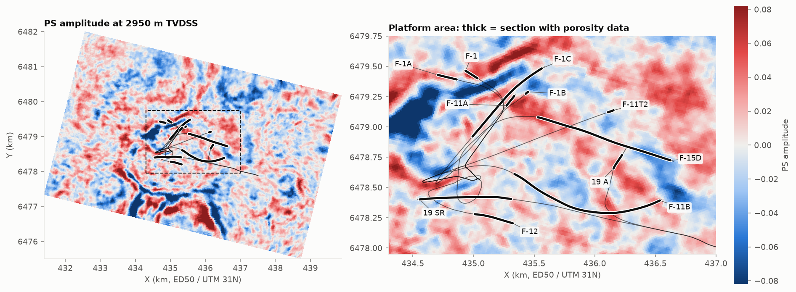
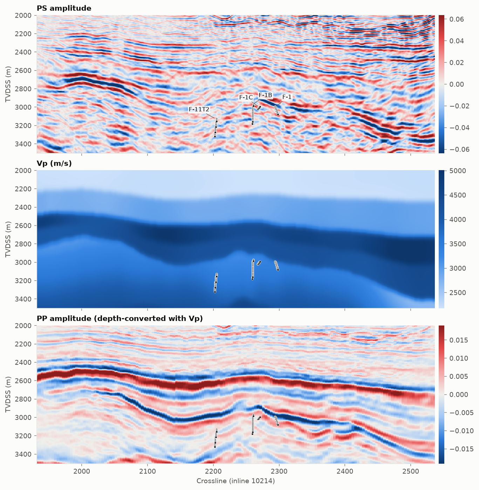
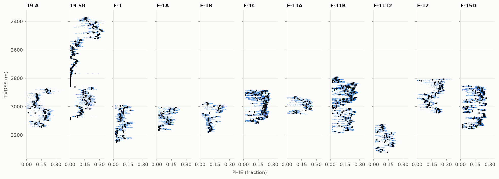

# volve-mlready

Loader, example notebooks and processing pipeline for the **Volve ML-ready** dataset. The
dataset is an analysis-ready subset of Equinor's public Volve field data (North Sea, block
15/9): three seismic-derived cubes on one depth grid, with the effective-porosity logs of
11 wellbores tied to it.

**Dataset (Zenodo):** https://doi.org/10.5281/zenodo.TODO · about 3.2 GB ·
Equinor Open Data Licence
**This code:** MIT



| | |
|---|---|
| Common grid | 901 × 385 × 605 cells (depth × inline × crossline), 12.5 × 12.5 × 5 m, 0–4500 m below MSL, ED50 / UTM 31N |
| Cubes on it | PS (converted-wave) amplitude · interval Vp (migration model) · PP amplitude (depth-converted) |
| Wells | 11 wellbores · 56,599 log samples · 1,105 upscaled voxels · target `PHIE` (effective porosity) |
| Extras | unified deviation surveys, per-well index, unmodified source files (LAS, surveys, checkshots, tops) |

The full data description (conventions, provenance, limitations) is in
[release/DATASET_README.md](release/DATASET_README.md). The same file ships as `README.md`
in the Zenodo record.

## Quick start

```bash
pip install git+https://github.com/attilalr/TODO-REPO-NAME     # numpy + pandas only
```

```python
from volve_mlready import VolveMLReady, download

download('data/volve-mlready-v1.0.0')            # from Zenodo; skips files already present
v   = VolveMLReady('data/volve-mlready-v1.0.0')
amp = v.cube('ps_amplitude')                     # (901, 385, 605) float32, memory-mapped
vox = v.wells('voxels')                          # one row per (well, voxel)
x   = amp[vox.IZ, vox.IY, vox.IX]                 # amplitude at every well voxel
y   = vox.PHIE                                   # target
```

`download(..., minimal=True)` skips the native-grid arrays and source files (about 2.5 GB
instead of 3.2 GB). You can also download the files by hand from Zenodo; the loader only
needs the folder.

## Notebooks

| Notebook | What it shows |
|---|---|
| [01_open_the_dataset.ipynb](notebooks/01_open_the_dataset.ipynb) | Every file, the grid and index conventions, coordinates, the well tables, building features at the wells, context windows, grouped validation |
| [02_exploration.ipynb](notebooks/02_exploration.ipynb) | Well locations, the three cubes along one inline, porosity logs, velocity with depth, cube values against porosity |

They are committed with their outputs, so GitHub shows them without running anything. To
run them yourself:

```bash
git clone https://github.com/attilalr/TODO-REPO-NAME && cd TODO-REPO-NAME
pip install -e ".[notebooks]"
export VOLVE_MLREADY_DIR=/path/to/volve-mlready-v1.0.0     # or put the files in data/
jupyter lab notebooks/
```





## Things to know before modelling

- The PS cube is **converted-wave** data, not P-wave. The PP cube was depth-converted with the
  migration velocity.
- Depths were tied from metadata only (drill-floor elevation). There is no synthetic
  seismogram, so misties of a few voxels are possible.
- Several wells share a slot. **Validate by well (leave-one-well-out), never by voxel.**
- Pooled correlations between single cube values and porosity are weak and change sign from
  well to well (notebook 2).

## Rebuilding the dataset from raw Volve data

`release/` holds the pipeline that produced the Zenodo files. It downloads the seismic from
the public OSDU mirror, ties the wells, co-registers the cubes and assembles the package.
See [release/pipeline/README.md](release/pipeline/README.md). It needs `segyio`, `lasio` and
`pyproj` (see `environment.yml`) and about 25 GB of disk.

## Licence and attribution

- **Code** in this repository: MIT ([LICENSE](LICENSE)).
- **Data** (on Zenodo, not in this repository): Equinor Open Data Licence. Commercial use is
  allowed, **selling the data is not**, and attribution is required. See
  [DATA_LICENSE.md](DATA_LICENSE.md).

> Contains data from the Volve field dataset, provided by Equinor ASA and the former Volve
> licence partners ExxonMobil Exploration & Production Norway AS and Bayerngas Norge AS,
> under the Equinor Open Data Licence (https://www.equinor.com/energy/volve-data-sharing).

This project is independent. It is not endorsed by Equinor, the Volve partners or OSDU.

## Citation

If you use the dataset, cite the Zenodo record (see [CITATION.cff](CITATION.cff)) and credit
the original Volve data as above.
